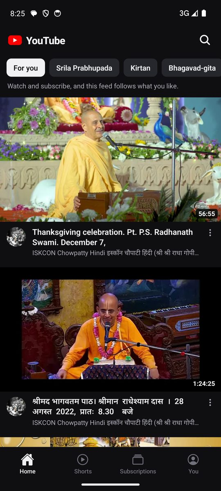
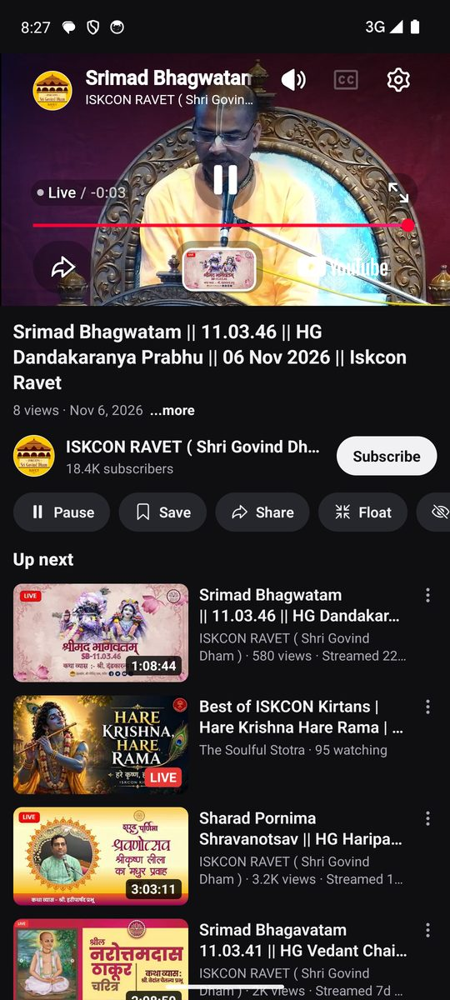

# ISKCON Tube

<p><a href="https://github.com/shivam1234-hub/iskcon-youtube/releases/latest/download/ISKCON-YouTube.apk"><b>⬇️ Download APK</b></a> · <a href="https://github.com/shivam1234-hub/iskcon-youtube/releases/latest">all versions</a><br><sub>Android: open the downloaded file and tap Install. You may need to allow installs from your browser first.</sub></p>

## Screenshots

<table><tr><td align="center"><br><sub>Home</sub></td><td align="center"><br><sub>Shorts</sub></td><td align="center"><br><sub>Watching a video</sub></td></tr></table>


A general YouTube client for Android: search anything, browse channels, keep subscriptions,
history and a Watch later list on the phone. Built from the Maharaj Vani app's player and
picture-in-picture code (Expo SDK 54 / React Native 0.81 / Expo Router).

## Screens

- **Home**: topic chips and a "For you" feed. The feed is built from your recent history
  (YouTube's own "Up next" for those videos) and the latest uploads of a few subscribed
  channels, interleaved. A new install falls back to popular videos.
- **Subscriptions**: newest uploads from every subscribed channel, merged and sorted by age.
- **You**: history, Watch later, subscribed channels and settings.
- **Search**: live suggestions and recent searches. **Results** has chips for videos, channels,
  newest, most viewed, under 4 min and over 20 min.
- **Watch**: player, description, channel with Subscribe, Save, Share, Float (PiP), autoplay and
  Up next. Picking an Up next video swaps it in place, so there is only ever one player.
- **Channel**: banner, avatar, subscriber count and every upload, with paging.

Long-press any video for Watch later, Share and Go to channel.

## Playback and what is NOT possible

Videos play in YouTube's official embedded player (see `utils/youtube.ts`, `youtubeEmbedHtml`).
- **Leaving the app** shrinks the player into a picture-in-picture window that keeps playing
  over other apps, with play/pause on the window and in a notification (`utils/pip.ts`,
  `android/.../PipModule.kt`).
- **Screen locked / app closed**: playback stops. The embed pauses itself whenever its page is
  hidden. That is how YouTube reserves background play for Premium. The only way round it is
  extracting raw streams (NewPipe-style), which breaks YouTube's terms and is deliberately not done.
- No downloads, and nothing that needs a Google account (comments, likes, real subscriptions).

## YouTube data, no API key

`utils/youtube.ts` reads the `ytInitialData` blob from desktop pages and pages further through
`youtubei/v1/{search,next,browse}` with the key and client version the page itself ships.
Suggestions come from `suggestqueries.google.com`. YouTube's RSS feeds return 404 (checked
2026-11-06), so subscriptions read each channel's `/videos` page instead.

Lists come in two shapes and both are parsed everywhere: `videoRenderer` (search) and
`lockupViewModel` (Up next, channel grids). This is the one part of the app that can break
without any change on our side.

## Build

Same recipe as the sibling apps (JDK 21 from Android Studio, network-timeout flags, arm64-only
splits, debug-key signing):

```bash
cd android && JAVA_HOME="/Applications/Android Studio.app/Contents/jbr/Contents/Home" \
  ./gradlew assembleRelease --no-daemon \
  -Dorg.gradle.internal.http.socketTimeout=180000 \
  -Dorg.gradle.internal.http.connectionTimeout=180000 \
  -Dorg.gradle.internal.repository.max.retries=6
```

Output: `android/app/build/outputs/apk/release/app-arm64-v8a-release.apk`.
Version bump = `app.json`, `package.json`, and `versionCode`/`versionName` in `android/app/build.gradle`.
Package id: `com.vanitube.app`, so it installs alongside Prabhupada Vani and Maharaj Vani.

## ISKCON-only filter

Every list (Home, topic chips, search and its suggestions, Up next, channel pages, Subscriptions,
History, Watch later) goes through `utils/iskcon.ts` `isIskconVideo`. There is no setting to turn
it off. A video shows only if it is **not blocked** (serials, episodes, promos, Shorts under 60 s,
TV channels, status/remix clips, films, named non-ISKCON gurus) **and** at least one of these:
- it is from a trusted ISKCON channel (the list in `iskcon.ts`)
- it is from a channel the app has learned is ISKCON
- it names ISKCON / Prabhupada / Hare Krishna / Mayapur / an ISKCON guru
- it pairs a devotee form of address (Prabhuji, Maharaj, Swami, Das, Mataji, HG, HH) with a devotional subject

To trust another channel, add its `UC...` id to `TRUSTED` in `utils/iskcon.ts`.

## Windows desktop app

`desktop/` is an Electron shell (Electron 44.4.4, electron-builder 26.15.3) over the Expo
**web** export. The desktop UI is web-only (`app/**/*.web.tsx`, `components/desktop/`): a
YouTube-desktop layout with a masthead search box, left guide, home grid, list-style results,
a two-column watch page, channel / History / Watch later / Hidden channels / Settings pages,
light and dark themes. The phone UI is untouched; both share `utils/`, `contexts/` and
`hooks/useHomeFeed.ts` / `hooks/useSubscriptionFeed.ts`, so every list goes through the same
`utils/iskcon.ts` rules.

```bash
npm run desktop:install   # once
npm run desktop           # export the web bundle and open the app
npm run desktop:build     # desktop/release/YouTube-Setup-<v>.exe + YouTube-<v>-portable.exe
```

How it differs from the phone:

| Phone | Desktop |
| --- | --- |
| `fetch` to youtube.com | `utils/ytFetch.web.ts` asks the main process (`desktop/lib/net.js`): a browser renderer would hit CORS |
| WebView wrapper page with a third-party baseUrl | iframe served from `http://127.0.0.1:47830` (fixed port, so localStorage persists) — the embed needs a real referrer or it fails with error 153 |
| Picture-in-picture (Float) | always-on-top mini player window (`desktop/float.html`) |
| Notification + earphone buttons | media keys (globalShortcut, held only on the watch page) |
| Voice search | hidden: Chromium's speech API in Electron fails with a `network` error |
| Long-press menu | hover ⋯ button and right-click |

Running from source on a Mac behind a TLS-intercepting proxy: `YT_DESKTOP_INSECURE=1`
(never set in a shipped build). `YT_SHOTS=<plan.json>` drives the screenshot harness in
`desktop/main.js`. If `ELECTRON_RUN_AS_NODE` is set in your shell, unset it first.
